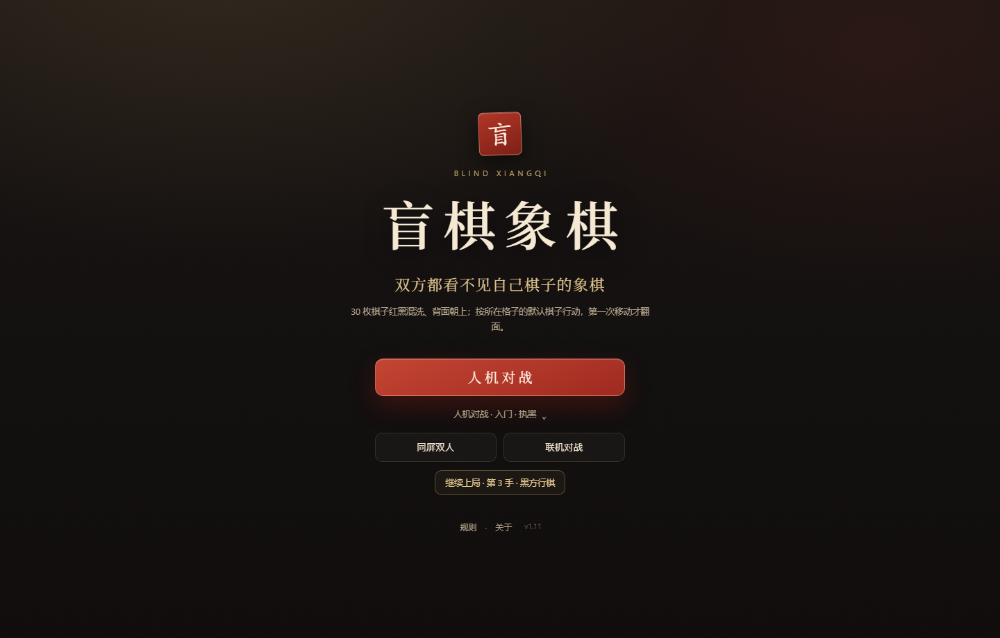

# 盲棋象棋 · Blind Xiangqi

> 中国象棋的隐藏信息变体：开局除将帅外，**30 枚棋子红黑混洗、全部背面朝上**。
> 暗子按**所在格子的默认棋子**行走、吃子、判定敌我；第一次移动才翻面现形。
> 双方信息完全对称，吃子记录是唯一的情报来源。

**当前版本：v1.11** · [规则规格 SPEC.md](SPEC.md) · [验收报告 REPORT.md](REPORT.md)



## 特性

- **规则完整**：全局混洗、表观阵营、翻面、误伤、九宫/河界、将军、困毙、重复/长将/自然限着。
- **人机对战（前端本地）**：`engine.js` + `ai.js` 全部在浏览器运行，可离线；AI 使用 PIMC、静止搜索、风险度量和暗子期望值。
- **联机 PvP（Python 后端）**：服务端持真相、下发 `PublicState` + 合法着法表；WebSocket 房间码、幂等落子、断线 resync、认输与终局揭示。
- **双端视角**：PvP 红方红底、黑方自动翻转 180°；规则坐标不变。
- **移动端 H5**：触控吸附、`100dvh`、安全区、无下拉刷新、手机点击修复。
- **常驻吃子记录**：只按「红方吃子 / 黑方吃子」两组显示圆形棋子 + 数量。
- **状态反馈**：PvP 显示「行棋中…」、同步 RTT、网络较慢和 8s 超时；AI 状态固定槽位，不挤压顶栏。

## 架构

```text
浏览器
├─ /           人机首页（本地 engine + AI，同页开局，可离线）
├─ /pvp/       联机首页（PvP，客户端不加载 engine/AI）
│   └─ /ws     WebSocket 房间
└─ /local/     兼容重定向到 /

FastAPI (server/app.py)
├─ /api/games  REST 对局
├─ /ws         房间 / 落子 / resync / 认输
└─ server/engine.py  Python 规则裁判（仅 PvP）
```

**分工原则**：PvE / 同屏全部前端本地；只有联机 PvP 使用后端。

## 快速开始

### 1. 离线人机 / 同屏

直接双击 `index.html`，无需构建、无需服务器。

### 2. 启动服务器

```powershell
python -m pip install -r server/requirements.txt
python -m server.serve
```

- 人机首页：<http://127.0.0.1:8000/>
- 联机 PvP：<http://127.0.0.1:8000/pvp/>
- API 文档：<http://127.0.0.1:8000/docs>

`server.serve` 默认绑定 `0.0.0.0`，会打印局域网地址；手机与电脑需在同一 Wi‑Fi，并允许防火墙的 8000 端口。

### 3. 可选：临时公网隧道

```powershell
# 终端 1
python -m server.serve --host 127.0.0.1

# 终端 2：先安装 cloudflared（https://developers.cloudflare.com/cloudflare-one/connections/connect-networks/downloads/）
cloudflared tunnel --url http://127.0.0.1:8000 --no-autoupdate --protocol http2 --edge-ip-version 4
```

会输出 `https://xxxx.trycloudflare.com`，H5 自动使用 `wss://`。免费 Quick Tunnel 无 uptime 保证，地址随机；公开传播前请加鉴权/访问控制。

## 操作

- 点击**表观阵营**为本方的暗子选中，再点落点；点对方暗子会提示不可操作。
- 翻面、吃子、误伤均由规则决定；吃子记录常驻。
- 人机首页主按钮「人机对战」直接开局；难度按钮可选择入门 / 进阶 / 高手。
- 人机对局底部「返回首页」同页回到首页。
- PvP：创建房间 → 分享 6 位房间码；红方先走，黑方视角自动翻转。
- 键盘：方向键移动焦点，`Enter` 选中/落子，`Esc` 取消。

## 测试

```powershell
# JS：规则 54 + AI 13 + 视觉 6 + UI 32 = 105
node tests/engine.test.cjs
node tests/ai.test.cjs
node tests/visual.test.cjs
node tests/ui.test.cjs

# Python：引擎 66 + API 6 + WebSocket 2 = 74
python -m unittest discover -s server/tests -v
```

合计 **179 条**，全部通过。

## 目录

```text
index.html              人机首页 / 对局（离线可玩）
src/
  engine.js             前端规则引擎
  ai.js                 前端 PIMC AI
  ui.js                 Canvas UI / 交互 / 吃子记录 / 存档
  visual.js             棋子、棋盘、翻面视觉
  styles.css            全站样式
server/
  engine.py             Python PvP 规则裁判
  app.py                FastAPI + WebSocket + 静态托管
  serve.py              LAN / 公网启动器
  tests/                74 条 Python 测试
web/
  pvp.html              PvP 首页（旧版布局）
  app.js                PvP 客户端
  client.css            PvP 样式
tests/                  105 条 Node 测试
scripts/                本地静态服务 / 自对弈 / 预览渲染
shots/                  README 截图
SPEC.md                 v1.11 规则规格
REPORT.md               实现与验收报告
```

## 已知限制

- PvP 尚未实现时钟、观战、完整重连 token、房间 TTL。
- 免费 Cloudflare Quick Tunnel 延迟/稳定性有限；需要稳定服务请用命名隧道或 VPS。
- 开发服务器无鉴权、CORS `*`，仅适合可信朋友局。
- 前端 PvE AI 的 AI-2 / AI-3 回归尚未完整跑完；AI-1 只跑了子集。
- 尚未加入 PWA / Service Worker。

## 规则与文档

- 完整规则：[SPEC.md](SPEC.md)
- 实现报告：[REPORT.md](REPORT.md)
- 后端说明：[server/README.md](server/README.md)

## License

本项目暂未指定开源许可证；如需复用，请先联系作者。
